# PACE — AI-vezérelt agilis gyorsító

*Egy AI-ügynök viszi a fejlesztés folyamatát — backlog, user story,
elfogadási kritérium, teszt, mérés —, és a döntési pontokon megáll az
emberi jóváhagyásért.*

> **Ez egy bemutató repó.** A PACE forráskódja és a példaprojektek külön,
> privát repókban élnek; itt a működését mutatom be a felületéről készült
> képekkel.
>
> **Fejlesztés alatt.** A képek a kiadas projekten mutatják a konzol
> 2026-11-02-i állapotát (az 5. és a 6. kép a G4 kapu régebbi, 2026-10-29-i
> állapotát, a mai konzollal megnyitva, mert a kiadas azóta minden kaput
> lezárt); a voice két képe 2026-10-20-i. A voice számai 2026-10-20-i, a
> kiadas számai 2026-10-30-i állapotot mutatnak (az SC4-költség
> 2026-11-02-án javítva). A keret folyamatosan változik, és a lenti két
> példaprojekt is a keret hibáinak feltárására készült.

---

## Mire való?

Egy agilis projekt elején sok idő megy el arra, hogy egy néhány mondatos
igényből rendezett, megbecsülhető és tesztelhető munka legyen. A PACE ezt a
réteget veszi át, és közben a szokásos adminisztrációt a munka
melléktermékévé teszi:

- **A backlog egy helyen él**, gépileg ellenőrzött szerkezetben. Minden elemnek
  azonosítója, elfogadási kritériuma és állapota van, és a lezárt elemhez
  bizonyíték (teszt vagy újrafuttatható mérés) tartozik.
- **A döntés nem marad a beszélgetésben.** Minden kérdés, válasz és döntés
  fájlba kerül, visszakereshetően.
- **Fázisonként egy kapu.** A kapunál egy determinisztikus ellenőrző lánc fut,
  utána egy független bíráló ügynök (írási jog nélkül) átnézi a munkát, és a
  kaput csak ember hagyhatja jóvá.
- **A GitHub a vitrin**: az issue-k a backlogból szinkronizálódnak, nem
  fordítva.

## A folyamat: hat kapu, mindegyik egy kérdés

A brieftől a tanulságig hat alapvonal-kapu vezet. Minden kapu egyetlen
kérdésre keres emberi választ.

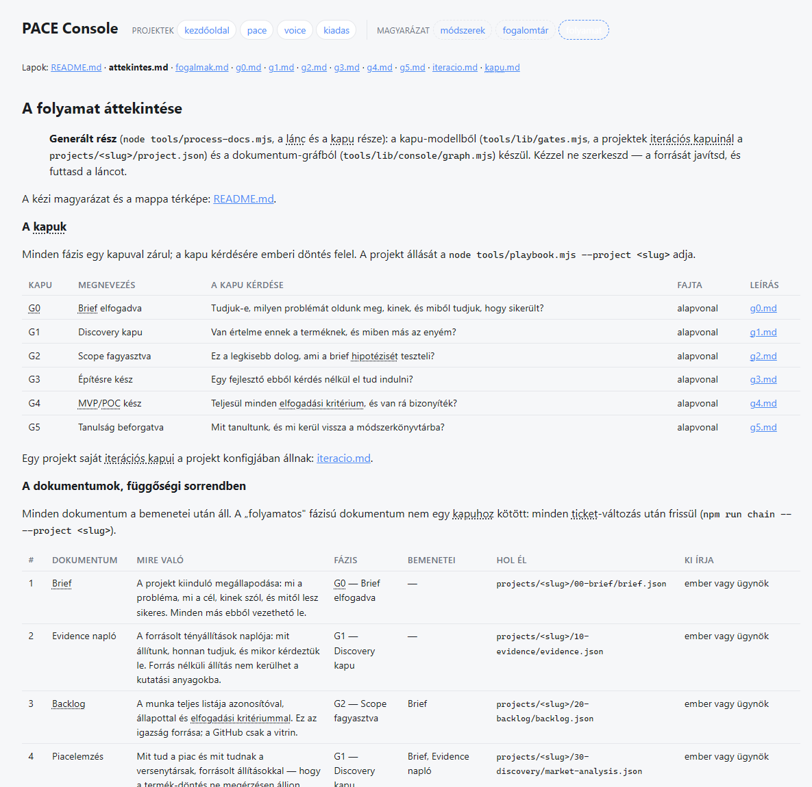

## Végig a felületen

A PACE-nek saját, böngészőben futó kezelőfelülete van (a „konzol”). A képek
a második példaprojekt, a *kiadas* valódi adataiból készültek: ez az első
projekt, amelyet a keret a saját felületéről indított, és amelynek a
brieftől a próbáig minden lépése itt követhető.

### 1. Indítás: egy brief, amely megmondja, mi hiányzik

Az új projekt egy űrlappal indul. Négy mező kötelező — a probléma, a cél,
legalább egy célfelhasználó és legalább egy siker-kritérium —, minden más
puha: ami hiányzik, azt a rendszer nyitott kérdésként vagy jelölt feltevésként
viszi tovább, nem találja ki. A formát váró mezők mellett minta áll (a kép az
űrlap tetejét mutatja), és a lap menet közben jelzi, mi hiányzik még.

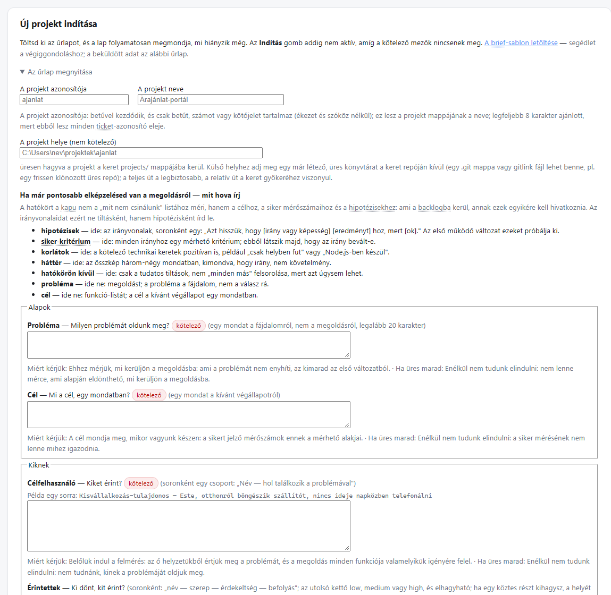

### 2. A brief egészségi lapja

A brief állapota három szinten: ami nélkül a projekt nem indul, ami hiányzik,
de nem állít meg, és ami kitöltött, de gyenge.

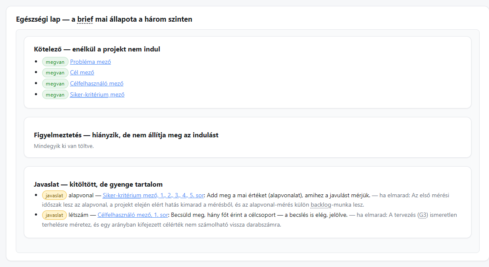

### 3. A brief AI-átnézése

Ha a brief gyenge, az AI tartalmi javaslatot tesz: kulccsal a konzol egy
nyelvi modellt (DeepSeek) hív, kulcs nélkül a Claude Code végzi ugyanezt.
**A javaslat sosem íródik magától a briefbe**: minden javaslatról ember dönt,
az elfogadott érték „következtetett” eredet-jelölést kap, az elvetett
indoklással a naplóban marad, és ami nem fogadható el, mellette nem gomb áll,
hanem az ok. A kiadas briefjére 17 javaslat született: 5-öt fogadtunk el, 12-t
indokkal elvetettünk (a kép az első ötöt mutatja).

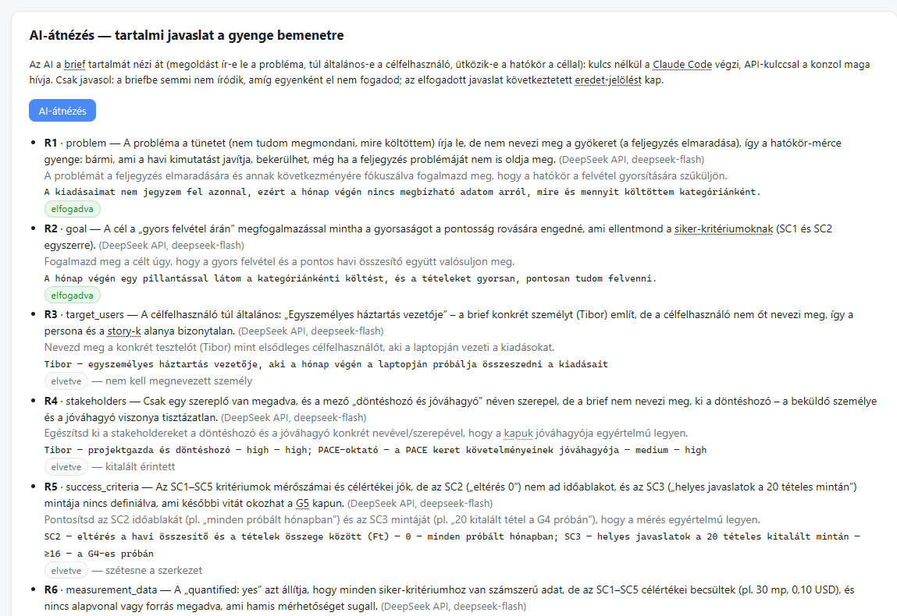

### 4. A kapuk állása

Egy kapu állapotát kizárólag a kapu-napló emberi döntése adja. A felületről a
jóváhagyás szándékosan nem futtatható: a napló írása a parancssoré, a
döntéssel és a bírálat mellékelt jelentésével együtt. A fenntartások — a
jóváhagyás feltételeként nyitva maradó feladatok — kapunként látszanak. A
kép a kiadas kapuit mutatja; a G1-nél a kihagyott dokumentum indoklása is
ott áll (kimondott saját-fejlesztésű tesztprojekt).

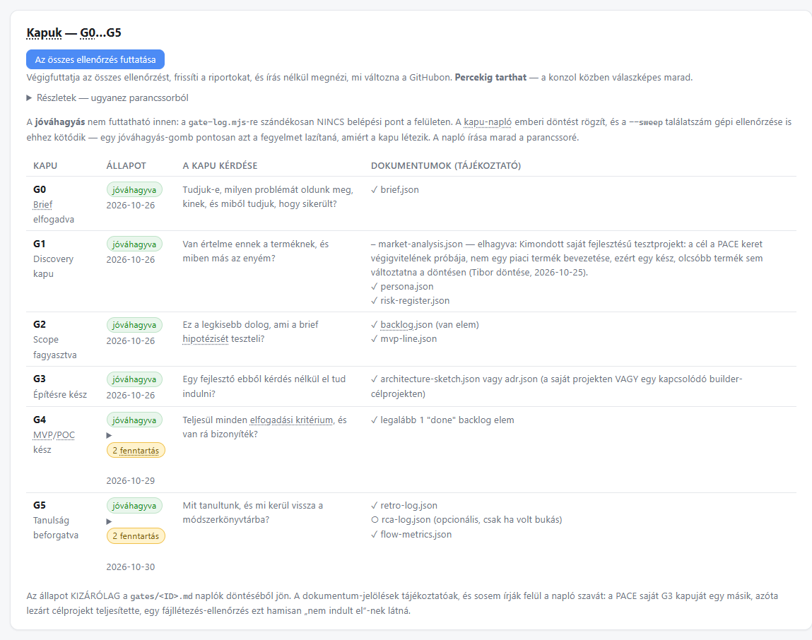

### 5. Mi a következő lépés?

A futó kapu lépései sorrendben: ki végzi (az ügynök, a felület vagy az
ember), mit kell tenni, és pontosan mit kell beírni vagy megnyomni. A kép a
kiadas G4 kapujának régebbi állapotát mutatja (2026-10-29, a bírálat első
köre után): a bírálat lefutott, az emberi döntés még várat magára.

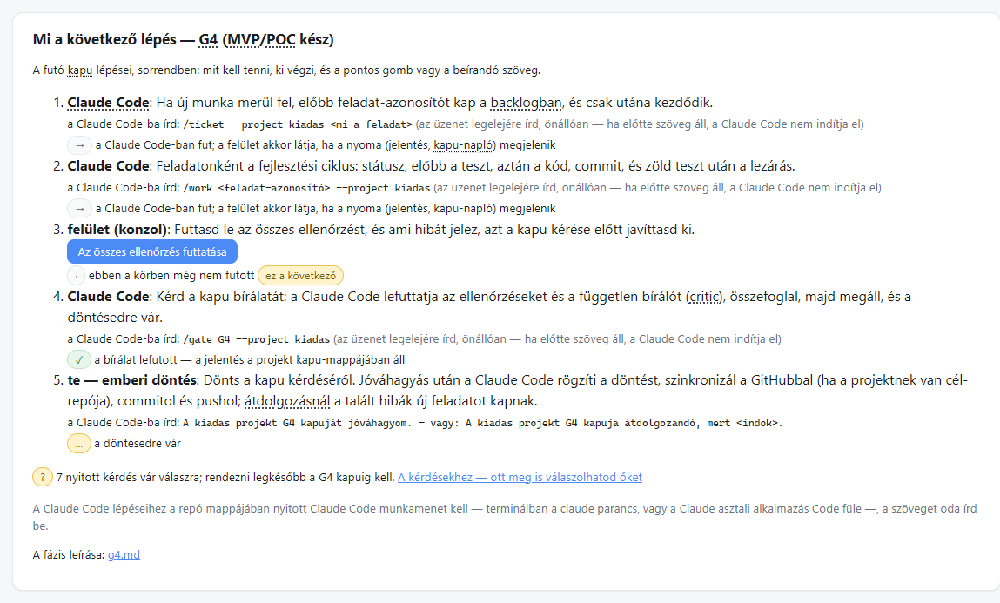

### 6. Kérdések, amelyek önmagukban érthetők

Az ügynök menet közben nem kérdezget, hanem összegyűjti a kérdéseket, és a
kapunál egyben teszi fel őket. Minden kérdés ugyanazt a szerkezetet követi:
mire vonatkozik, mit javasol az ügynök, mi az ára, és mi a másik lehetőség.
A felület feloldja, mire hivatkozik a kérdés, és a válasz ugyanitt adható
meg — ha valami nem érthető, a „Visszakérdezek” gombbal az ügynök kifejti.
A kép ugyanabból az állapotból készült, mint az előző (a hét nyitott
kérdésből az első ötöt mutatja).

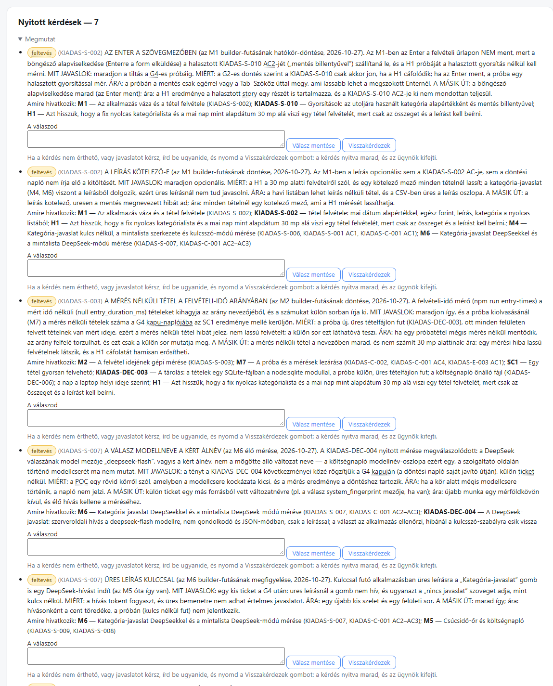

### 7. Backlog és nyomon követhetőség

A backlog fában: epic, story, spike, chore, mindegyiknél az állapot, a
becslés, az elfogadási kritériumok és a tesztek száma, és a GitHub-issue
száma. Az elejtett („dropped”) elemek külön jelölést kapnak, nem tűnnek el.

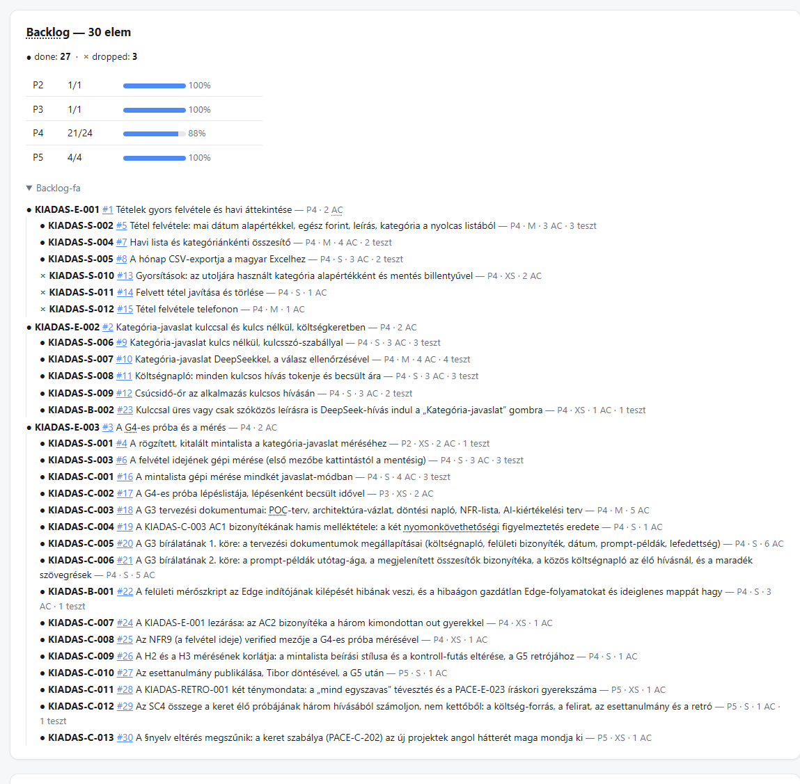

### 8. Mérés

A mérőszámokat a gép számolja a projekt adataiból — a kapuk jóváhagyási
aránya, a bírálati körök, a nyitott kérdések, az emberi döntések száma —, és
mindegyik kimondja, mire épül és mit nem mér.

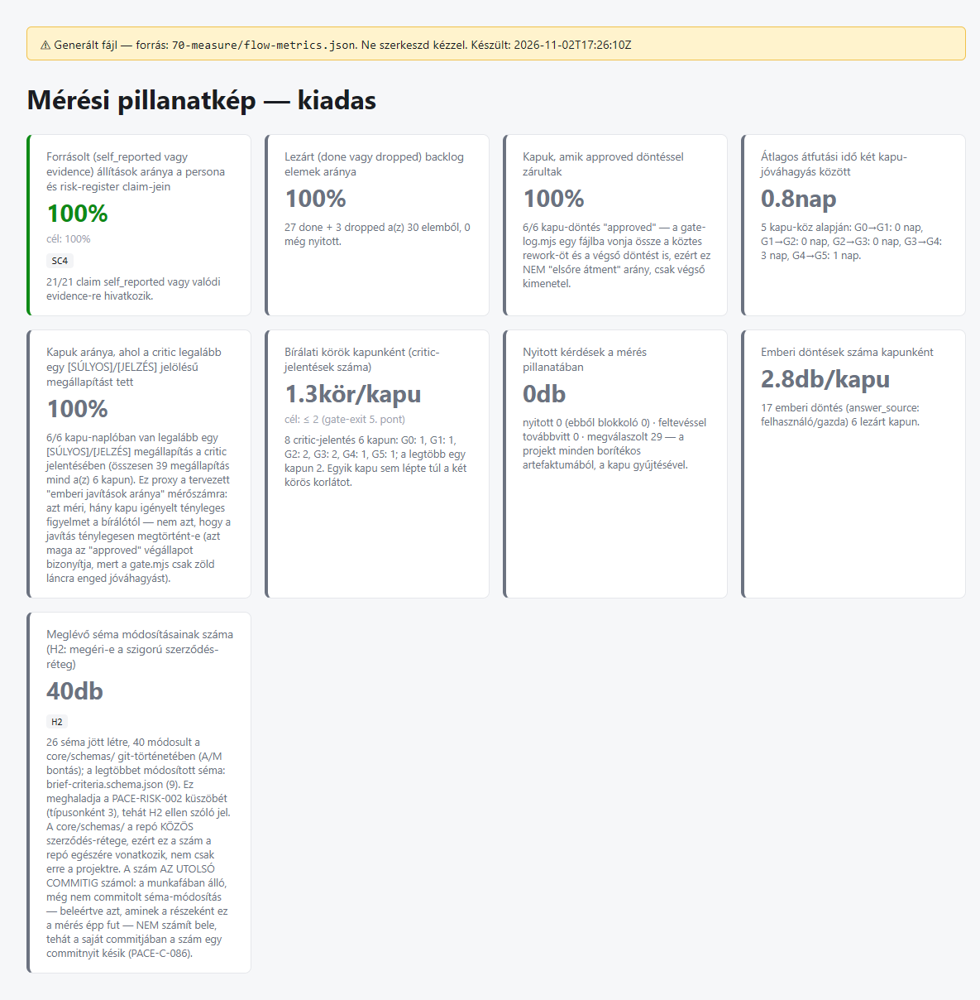

## Példaprojekt: voice

A *voice* egy szimulált pilot: egy hang- és szövegjegyzetelő webalkalmazás
(PWA), amelyet egy AI-ügynök a PACE keretben vitt végig a brieftől a működő
POC-ig. Nem lesz éles termék; a célja annak megmutatása, hogy a keret egy
idegen projektet is követhetően vezet végig, és közben a keret saját hibáit
is feltárja. A hangátírás helyben futó nyílt modellel (Whisper) készül,
fizetős szolgáltatás nélkül.

2026-10-20-án mérve: mind a hat kapu jóváhagyással zárult, a G2–G5
fenntartásokkal; a záró kapu első futását a bíráló egy elavult szám miatt
visszaküldte, az új futás egy kör után ment át. A teljes esettanulmány a
számokkal, a tanulságokkal és a korlátokkal:
[esettanulmany-voice.md](esettanulmany-voice.md).

Összehasonlításul a voice kapui és mérési pillanatképe a konzol
2026-10-20-i állapotában (a voice-nál nagyobb a backlog, és a G2–G5 több
fenntartással zárult, mint a kiadas kapui):

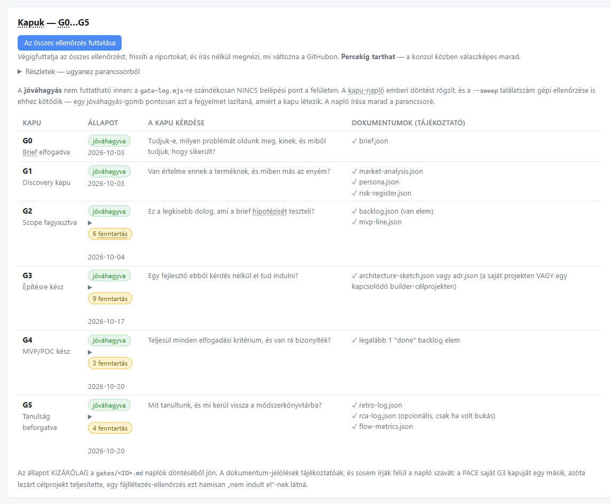

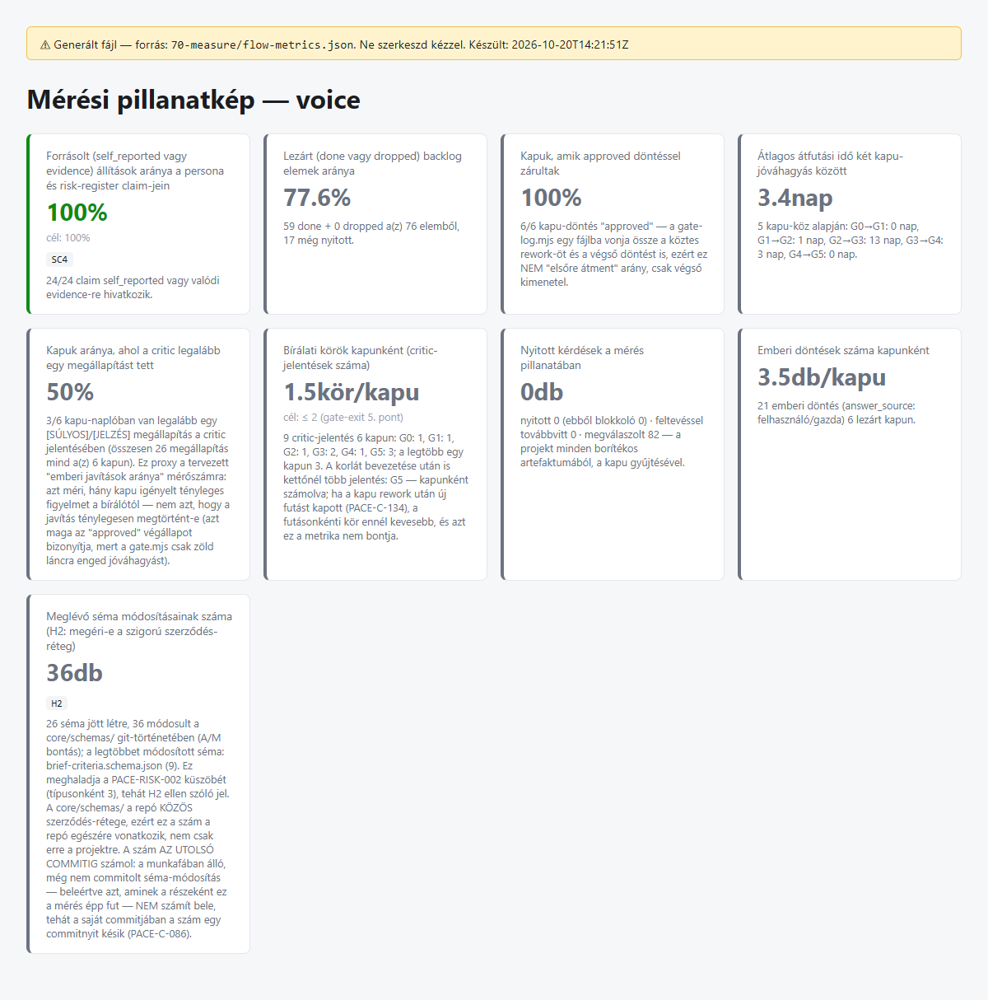

## Második példaprojekt: kiadas

A *kiadas* egy helyben futó kiadásnapló egyszemélyes háztartásnak,
kategória-javaslattal: kulccsal egy nyelvi modell (DeepSeek), kulcs nélkül
egy kulcsszó-szabály javasol. Ez az első projekt, amelyet a keret a saját
felületéről indított: a brieftől a működő POC-ig és egy valódi, egyestés
próbáig ugyanaz az ügynök vitte, a kódot egy külön építő ügynök írta.

2026-10-30-án mérve: mind a hat kapu jóváhagyással zárult (a G4 és a G5
fenntartással), egyik sem lépte túl a két bírálati kört; a próbán a négy
hipotézis igazolódott, kettő kimondott mérési korláttal. A nyelvi modell
teljes költsége a leolvasás szerint 0,01 USD volt a 0,10 USD-s keretből. A
kör legfontosabb tanulsága, hogy a hosszú, körülíró mintán mért pontosság a
valódi, rövid (többnyire egyszavas) beírásra optimista — ezt csak egy valódi bemeneten futó
kontroll mutatta meg. A teljes esettanulmány:
[esettanulmany-kiadas.md](esettanulmany-kiadas.md).

## Amit ez a bemutató nem állít

- A voice szimulált környezetben futott: valódi tesztcsoport és hónapokig
  tartó használat nélkül a termék-hipotézisei nem igazoltak.
- A kiadas próbáját egy ember tartotta, tíz tétellel, egy estén: a
  hipotézisei egy hónapnyi valódi használaton nem mértek.
- A számok egy adott napra vonatkoznak, és a keret fejlesztése közben
  változnak.
- A bírálati megállapítások aránya ma alsó korlát: a mérés a korábbi kapuk
  egy részének jelölését nem ismeri fel (a javítása nyitott feladat).

## Technológia röviden

- Node.js, külső csomagfüggés nélküli eszközlánc; minden artefaktum
  sémával ellenőrzött JSON
- AI-ügynök (Claude Code) végzi a munkát, egy külön bíráló ügynök a
  minőségi kaput
- Böngészős kezelőfelület a folyamathoz, a kérdésekhez és a méréshez
- GitHub-szinkron: a backlogból issue-k, a lezárás a commitból

## Több részlet kérésre

Aki a fejlesztés lépéseit, a folyamatleírást vagy a kódszerkezetet
részletesebben is látná, annak szívesen megmutatom.
