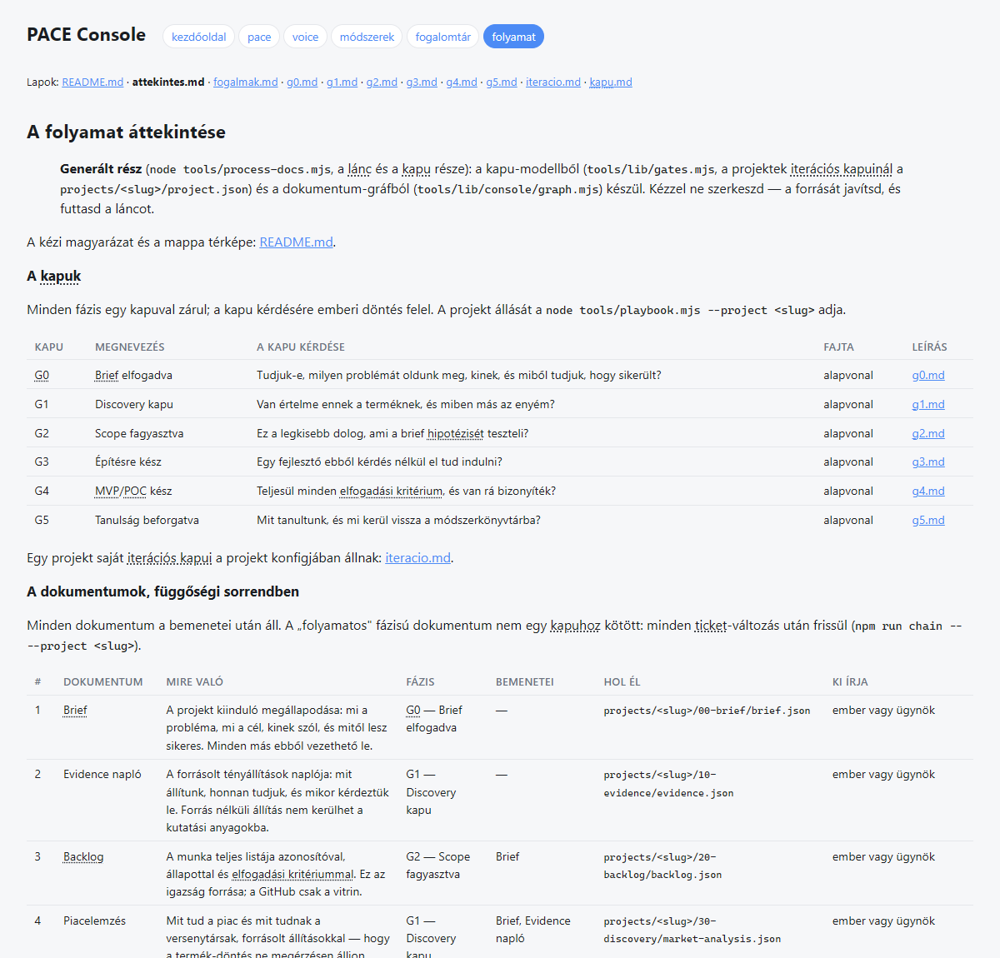
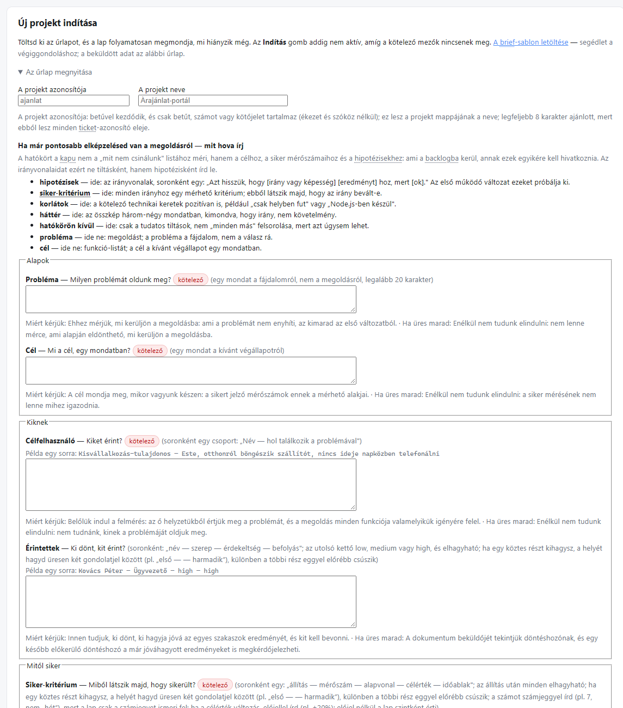
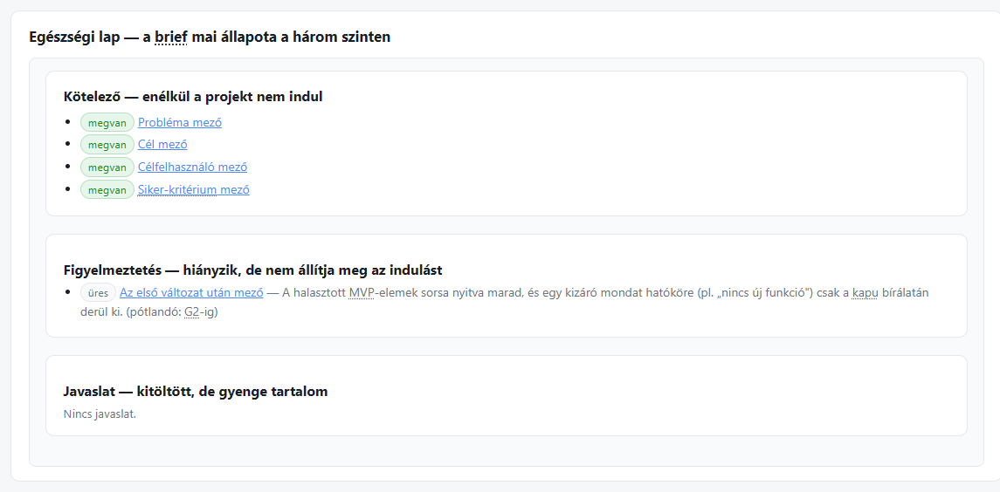
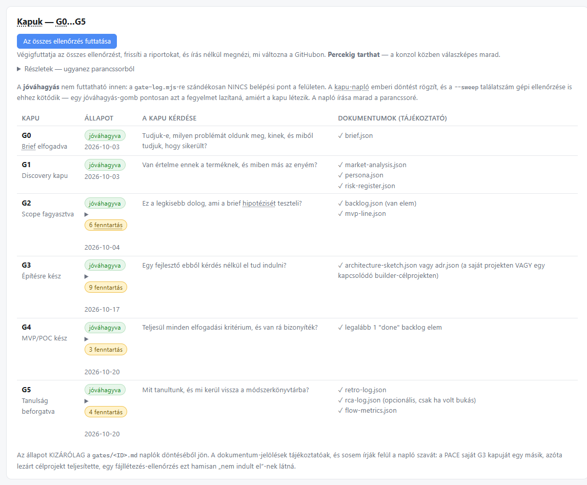
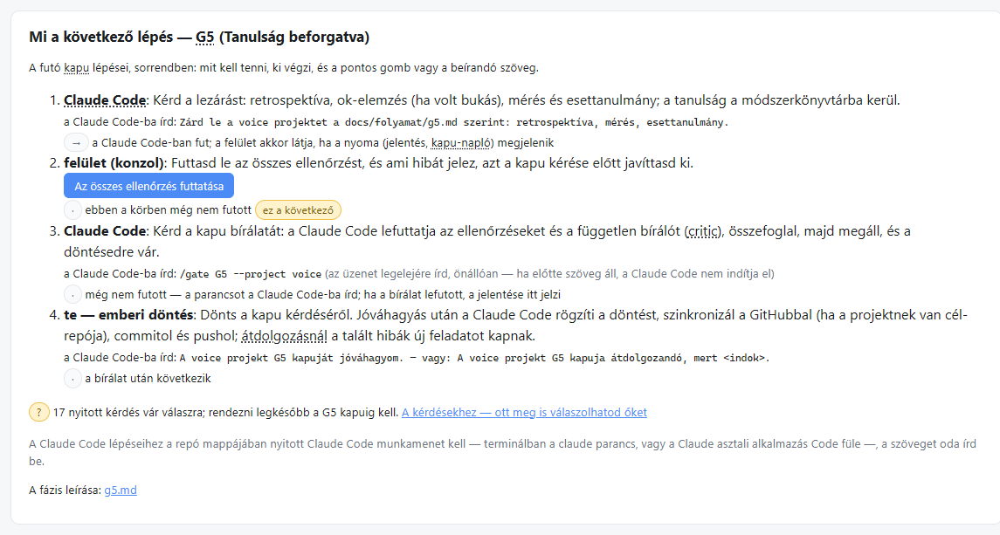
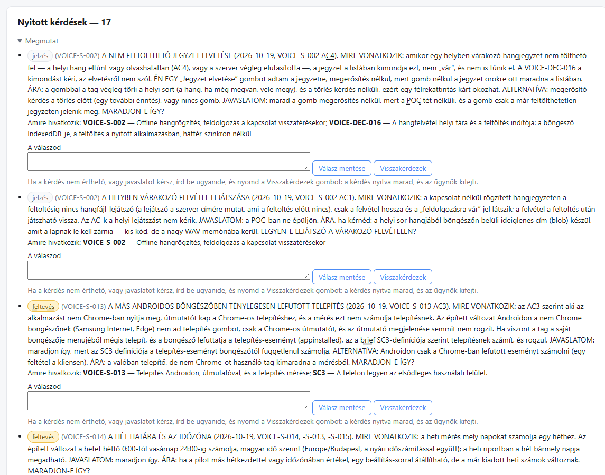
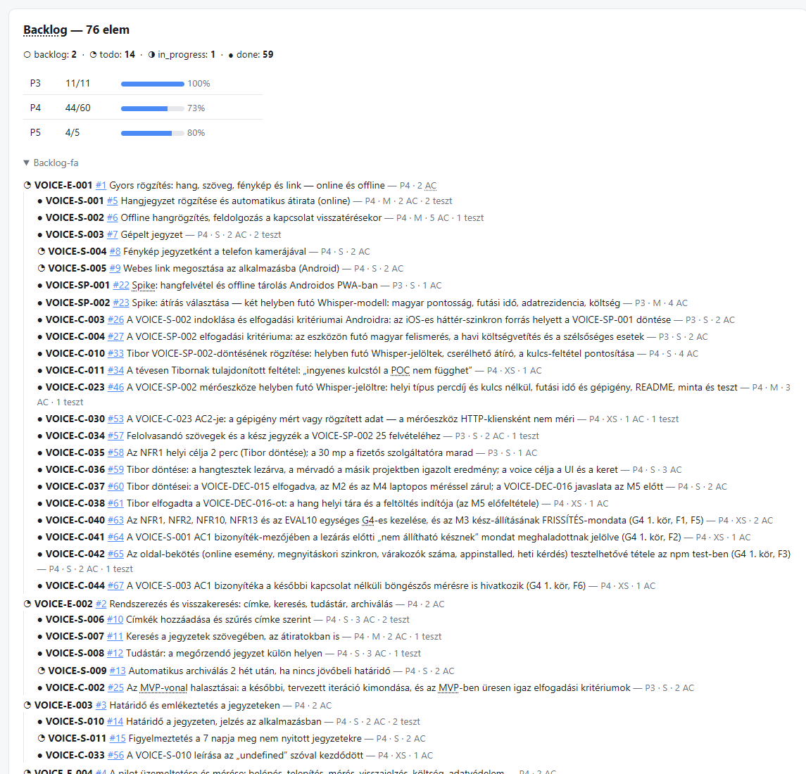
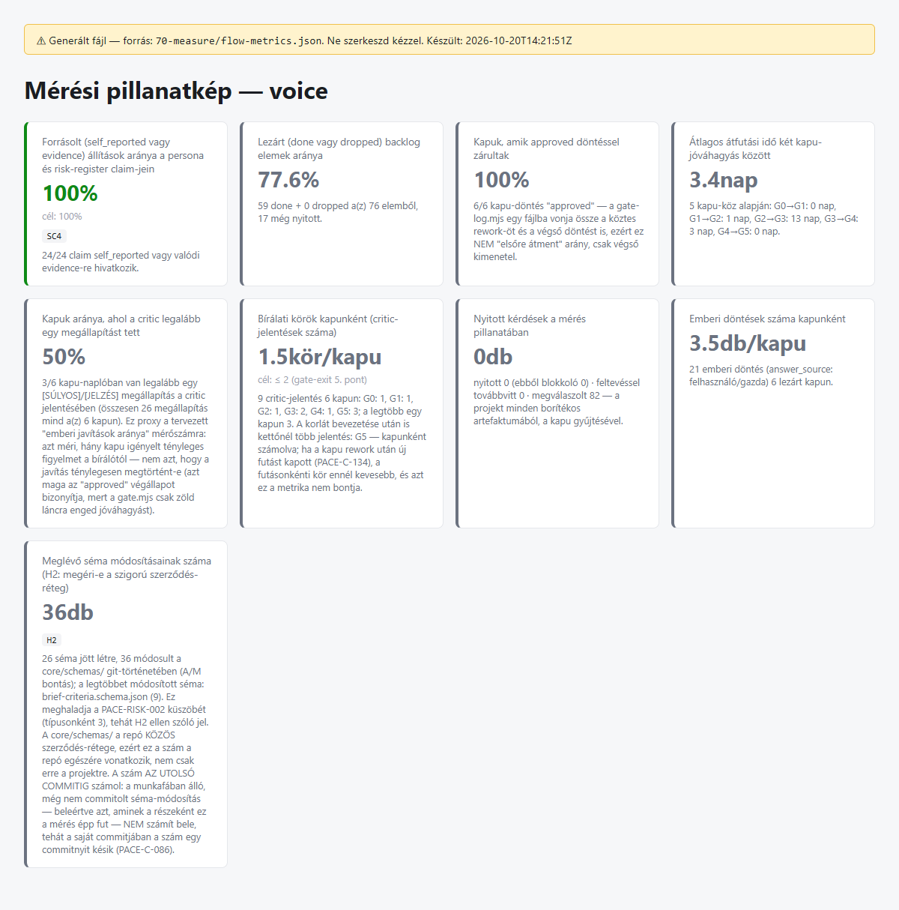

# PACE — AI-vezérelt agilis gyorsító

*Egy AI-ügynök viszi a fejlesztés folyamatát — backlog, user story,
elfogadási kritérium, teszt, mérés —, és a döntési pontokon megáll az
emberi jóváhagyásért.*

> **Ez egy bemutató repó.** A PACE forráskódja és a példaprojekt külön, privát
> repókban él; itt a működését mutatom be a felületéről készült képekkel.
>
> **Fejlesztés alatt.** A képek és a számok 2026-10-20-i állapotot mutatnak.
> A keret folyamatosan változik, és a lenti példaprojekt is a keret hibáinak
> feltárására készült.

---

## Mire való?

Egy agilis projekt elején sok idő megy el arra, hogy egy néhány mondatos
igényből rendezett, megbecsülhető és tesztelhető munka legyen. A PACE ezt a
réteget veszi át, és közben a szokásos adminisztrációt a munka
melléktermékévé teszi:

- **A backlog egy helyen él**, gépileg ellenőrzött szerkezetben. Minden elemnek
  azonosítója, elfogadási kritériuma és állapota van, és a lezárt elemhez
  bizonyíték (teszt vagy újrafuttatható mérés) tartozik.
- **A döntés nem marad a beszélgetésben.** Minden kérdés, válasz és döntés
  fájlba kerül, visszakereshetően.
- **Fázisonként egy kapu.** A kapunál egy determinisztikus ellenőrző lánc fut,
  utána egy független bíráló ügynök (írási jog nélkül) átnézi a munkát, és a
  kaput csak ember hagyhatja jóvá.
- **A GitHub a vitrin**: az issue-k a backlogból szinkronizálódnak, nem
  fordítva.

## A folyamat: hat kapu, mindegyik egy kérdés

A brieftől a tanulságig hat alapvonal-kapu vezet. Minden kapu egyetlen
kérdésre keres emberi választ.

## Végig a felületen

A PACE-nek saját, böngészőben futó kezelőfelülete van (a „konzol”). A képek
a példaprojekt, a *voice* valódi adataiból készültek.

### 1. Indítás: egy brief, amely megmondja, mi hiányzik

Az új projekt egy űrlappal indul. Négy mező kötelező — a probléma, a cél,
legalább egy célfelhasználó és legalább egy siker-kritérium —, minden más
puha: ami hiányzik, azt a rendszer nyitott kérdésként vagy jelölt feltevésként
viszi tovább, nem találja ki. A formát váró mezők mellett minta áll, és a lap
menet közben jelzi, mi hiányzik még.

### 2. A brief egészségi lapja

A brief állapota három szinten: ami nélkül a projekt nem indul, ami hiányzik,
de nem állít meg, és ami kitöltött, de gyenge.

### 3. A kapuk állása

Egy kapu állapotát kizárólag a kapu-napló emberi döntése adja. A felületről a
jóváhagyás szándékosan nem futtatható: a napló írása a parancssoré, a
döntéssel és a bírálat mellékelt jelentésével együtt. A fenntartások — a
jóváhagyás feltételeként nyitva maradó feladatok — kapunként látszanak.

### 4. Mi a következő lépés?

A futó kapu lépései sorrendben: ki végzi (az ügynök, a felület vagy az
ember), mit kell tenni, és pontosan mit kell beírni vagy megnyomni. A kép a
voice-nak azt az állapotát mutatja, amikor a G4 már jóváhagyott volt, és a
záró G5 következett.

### 5. Kérdések, amelyek önmagukban érthetők

Az ügynök menet közben nem kérdezget, hanem összegyűjti a kérdéseket, és a
kapunál egyben teszi fel őket. Minden kérdés ugyanazt a szerkezetet követi:
mire vonatkozik, mit javasol az ügynök, mi az ára, és mi a másik lehetőség.
A felület feloldja, mire hivatkozik a kérdés, és a válasz ugyanitt adható
meg — ha valami nem érthető, a „Visszakérdezek” gombbal az ügynök kifejti.
A kép ugyanabból az állapotból készült, mint az előző.

### 6. Backlog és nyomon követhetőség

A backlog fában: epic, story, spike, chore, mindegyiknél az állapot, a
becslés, az elfogadási kritériumok és a tesztek száma, és a GitHub-issue
száma.

### 7. Mérés

A mérőszámokat a gép számolja a projekt adataiból — a kapuk jóváhagyási
aránya, a bírálati körök, a nyitott kérdések, az emberi döntések száma —, és
mindegyik kimondja, mire épül és mit nem mér.

## Példaprojekt: voice

A *voice* egy szimulált pilot: egy hang- és szövegjegyzetelő webalkalmazás
(PWA), amelyet egy AI-ügynök a PACE keretben vitt végig a brieftől a működő
POC-ig. Nem lesz éles termék; a célja annak megmutatása, hogy a keret egy
idegen projektet is követhetően vezet végig, és közben a keret saját hibáit
is feltárja. A hangátírás helyben futó nyílt modellel (Whisper) készül,
fizetős szolgáltatás nélkül.

2026-10-20-án mérve: mind a hat kapu jóváhagyással zárult, a G2–G5
fenntartásokkal; a záró kapu első futását a bíráló egy elavult szám miatt
visszaküldte, az új futás egy kör után ment át. A teljes esettanulmány a
számokkal, a tanulságokkal és a korlátokkal:
[esettanulmany-voice.md](esettanulmany-voice.md).

## Amit ez a bemutató nem állít

- A voice szimulált környezetben futott: valódi tesztcsoport és hónapokig
  tartó használat nélkül a termék-hipotézisei nem igazoltak.
- A számok egy adott napra vonatkoznak, és a keret fejlesztése közben
  változnak.
- A bírálati megállapítások aránya ma alsó korlát: a mérés a korábbi kapuk
  egy részének jelölését nem ismeri fel (a javítása nyitott feladat).

## Technológia röviden

- Node.js, külső csomagfüggés nélküli eszközlánc; minden artefaktum
  sémával ellenőrzött JSON
- AI-ügynök (Claude Code) végzi a munkát, egy külön bíráló ügynök a
  minőségi kaput
- Böngészős kezelőfelület a folyamathoz, a kérdésekhez és a méréshez
- GitHub-szinkron: a backlogból issue-k, a lezárás a commitból

## Több részlet kérésre

Aki a fejlesztés lépéseit, a folyamatleírást vagy a kódszerkezetet
részletesebben is látná, annak szívesen megmutatom.
