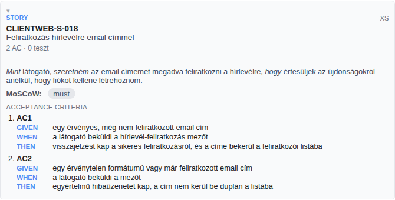
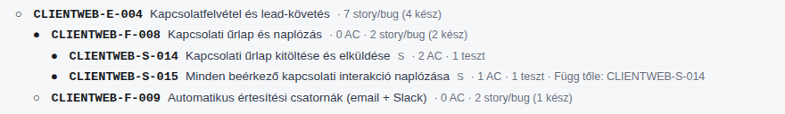

# 🤖 PACE — AI-vezérelt agilis gyorsító

*Scrum Masterek, Product Ownerek és projektmenedzserek munkáját segítő AI-eszköz —
egy homályos, néhány mondatos ügyfél-igényből percek alatt épít strukturált,
tesztelhető backlogot.*

> **Ez egy showcase repó.** A tényleges alkalmazás egy külön, folyamatosan
> fejlesztett munkarepóban él — itt csak azt mutatom be röviden, mire való és
> hogyan működik, a teljes forráskód másolása nélkül.

---

## 🎯 Kinek és mire jó?

Egy agilis projekt indulásakor rengeteg idő megy el arra, hogy egy homályos
ügyféligényből (pl. "szeretnék egy új weboldalt, kb. ezt és ezt tudja")
rendezett, megbecsülhető és tesztelhető feladatlista legyen — epikák,
funkciók, user story-k, elfogadási kritériumok. A PACE ezt a réteget veszi át:

- **Scrum Masternek** — a backlog karbantartása, a minőségellenőrzés
  (hiányos elfogadási kritérium, indokolatlan döntés, félrecsúszott
  függőség) és a haladás mérése nem külön adminisztráció, hanem a folyamat
  automatikus mellékterméke.
- **Product Ownernek** — minden priorizálási döntés (mi kerüljön az első
  verzióba, mi ne) indoklással együtt születik, nem megérzésből.
- **Projektmenedzsernek** — ugyanabból a bemenetből hagyományos
  projektterv-szerű nézet (feladatfa, felelősök, függőségek) is előáll,
  nem kell külön eszközben duplán vezetni.

## ⚙️ Hogyan működik? (dióhéjban)

1. **Bemenet:** egy rövid, akár hiányos ügyfél-igény vagy kitöltött
   brief-sablon.
2. **Lebontás:** az AI-ügynök feladatfává alakítja — epikák, funkciók,
   user story-k —, mindegyikhez konkrét, ellenőrizhető elfogadási
   kritériummal.
3. **Minőségi kapu:** ha egy döntéshez nincs elég információ, a rendszer
   nem talál ki választ — nyitott kérdésként jelzi, és megvárja az emberi
   döntést.
4. **Nyomon követhetőség:** minden állítás és döntés visszakereshető a
   forrásáig; minden lezárt feladathoz tartozik teszt is.
5. **Kimenet:** prezentálható riportok (backlog-nézet, projektterv-szerű
   összesítés), amik igény esetén egy tracker-eszközzel (pl. GitHub)
   szinkronban tarthatók.

## 📸 Képernyőképek

**Egy generált user story, elfogadási kritériummal:**

**A backlog fa-nézete — hány feladat tartozik egy nagyobb egységhez, és mi
kész belőle:**

## 📄 Bizonyíték — élő próba

A mellékelt PDF egy valódi, végigvitt esetet mutat be: egy néhány mondatos,
homályos ügyfél-brieftől a kész, tesztelhető backlogig, kiegészítve egy
helyszíni, rögtönzött próbával (egy váratlan, új igény szétvágásával).

## 🧰 Technológia (röviden)

- Node.js-alapú, önálló folyamat — nincs külső szolgáltatásfüggés a
  működéshez
- AI-ügynök (LLM) végzi a tényleges lebontást és a minőségellenőrzést
- Strukturált, ellenőrzött adatmodell minden artefaktumhoz
- GitHub-alapú munkafolyamat és verziókövetés
- A fejlesztés AI-asszisztált módszerrel ("vibe coding") készült

## 📬 Több részlet kérésre

Aki a projekt tényleges fejlesztési lépéseit, a folyamat és a kódszerkezet
részleteit is szeretné látni, annak szívesen küldöm a teljes fejlesztési
dokumentációt.
